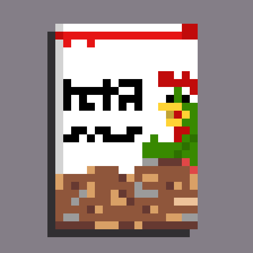
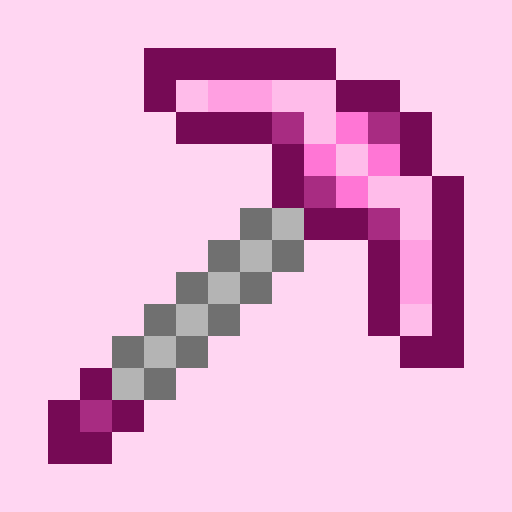
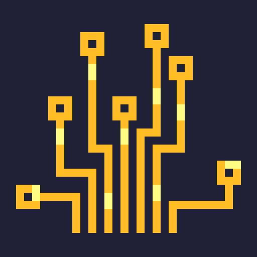
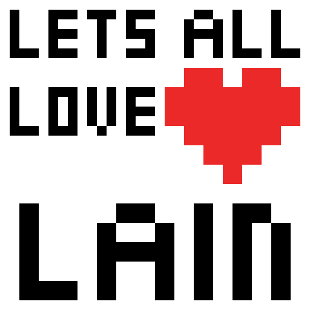

# Logros de Lain Chikita

Hay **11 logros**: 5 por subir de nivel y 6 que se desbloquean con una acción. Todos se pueden conseguir tanto en Android como en PC.

- **Android**: los logros son de Google Play Games. Hay que conectarse con Google en la pantalla de datos del juego (la última pantalla, deslizando a la derecha) y desde ahí también se ven.
- **PC (Linux y Windows)**: los logros son locales y se ven con el botón **Logros** de la pantalla de datos del juego. Se guardan dentro del archivo `.save` al respaldar el progreso.

Subir un nivel = llenar la barra de amor (20 clics a Lain).

## Por nivel

| | Logro | Descripción | Rareza | Android | PC |
|---|---|---|---|---|---|
|  | **Beginner** | This is just the beginning | Común | Llegar a nivel 50 ¹ | Llegar a nivel 1 |
|  | **Love is in the air** | Love is in the air | Poco común | Llegar a nivel 50 | Llegar a nivel 50 |
|  | **Lain Chikita lover** | Let's All Love Lain Chikita | Raro | Llegar a nivel 100 | Llegar a nivel 100 |
|  | **Cereal enjoyer** | You really love cereal, don't you? | Épico | Llegar a nivel 1000 | Llegar a nivel 1000 |
|  | **Love miner** | You really love mining, don't you? | Legendario | Llegar a nivel 5000 | Llegar a nivel 5000 |

¹ En Android, *Beginner* se desbloquea en el nivel 50 junto con *Love is in the air* (ver [Notas](#notas)).

## Por acción

| | Logro | Descripción | Rareza | Android | PC |
|---|---|---|---|---|---|
|  | **God is watching you** 🔒 | God is watching you, but you don't need to be afraid | Legendario | Hacer clics demasiado rápido o con autoclicker hasta que salga la pantalla de bloqueo | Igual que en Android |
|  | **Keep your love safe** | Save your progress | Común | **Guardar progreso** en la nube (con sesión de Google) | **Guardar progreso** en un archivo `.save` |
|  | **Welcome to the Wired** | Load your progress | Poco común | **Cargar progreso** desde la nube | **Cargar progreso** desde un archivo `.save` |
|  | **I have lost it all** 🔒 | Oops! you lost your money | Legendario | Cargar progreso de la nube teniendo al menos 1 moneda (las monedas no se guardan, así que se pierden) | Cargar un `.save` teniendo al menos 1 moneda (igual, las monedas no van en el archivo) |
|  | **Let's All Love Lain** 🔒 | Let's All Love Lain | Legendario | Canjear un código de accesorio válido, aunque ya tengas el accesorio o ya no queden accesorios | Tocar el botón **Canjear código** (en PC no se pueden canjear códigos reales) |
|  | **Pretty girl** | You're so pretty | Raro | Elegir cualquier accesorio en el inventario | Igual que en Android |

🔒 = logro oculto: no se ve qué es hasta desbloquearlo.

## Notas

- Las **monedas** se ganan cada 100 niveles y sirven para comprar accesorios al azar. Ni la nube ni el `.save` guardan monedas, para que no se puedan duplicar (guardar, gastar y volver a cargar). Por eso existe *I have lost it all*.
- En **Android** los logros de nivel son incrementales en Play Games: la app les suma 50 pasos cada 50 niveles (50, 100, 150...). Por eso *Beginner*, aunque pide nivel 1, recibe sus primeros pasos en el nivel 50 y se desbloquea ahí junto con *Love is in the air*.
- En **PC** se cuentan las subidas de nivel. Si alguien ya tenía niveles antes de que existieran los logros locales, al abrir la app la cuenta se iguala a su nivel actual y recibe los logros que le corresponden.
- Cargar un `.save` reemplaza el progreso **y los logros** por los del archivo.

## Para desarrolladores

- Definición local de los logros: `lain_chikita/lib/data/achievements_catalog.dart`. El enum `GameAchievement` une el id local con el id de la Play Console.
- Los niveles de los logros de nivel en `localAchievements` siguen a los de la Play Console (1/50/100/1000/5000). La única diferencia es *Beginner*: en Android cae en el nivel 50 por cómo se suman los pasos, y se dejó así a propósito.
- Íconos en 512x512 (formato de la Play Console): esta carpeta, `512x512/`.
